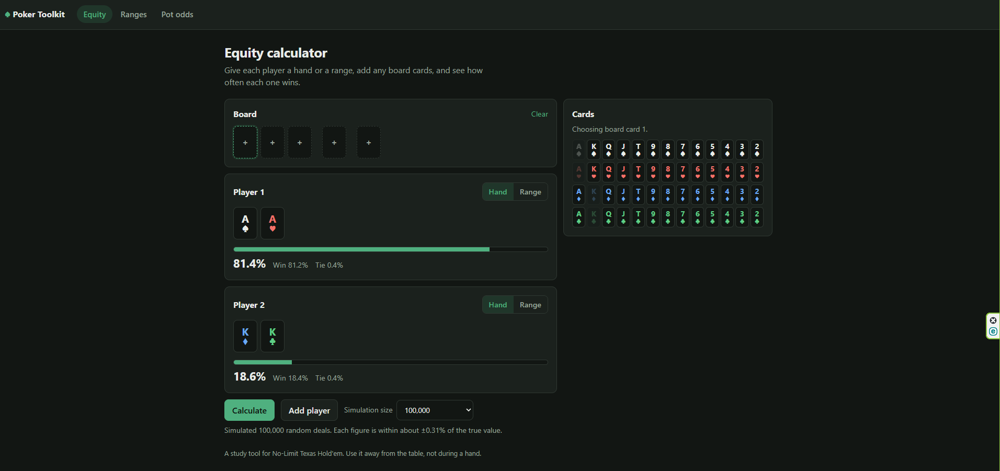

# Poker Toolkit

A No-Limit Texas Hold'em study tool built in C# and Blazor WebAssembly. Calculate hand equity, build preflop ranges, and work through pot odds and EV, all in the browser.

[](https://github.com/woodluke220/poker-toolkit/actions/workflows/deploy.yml)

**[Try it live →](https://woodluke220.github.io/poker-toolkit/)**



## Why I built this

I play a lot of poker with friends, and the more I played, the more I wanted to understand what was going on underneath the cards. The deeper I dug, the clearer it became that strong players aren't guessing. They know their odds, they know what the pot is offering them, and they know when a bet makes sense and when to let a hand go.

I wanted a tool that shows me those numbers so I can start building the same instincts. It also gave me a good excuse to write something real in C#.

## Features

**Equity calculator.** Give each player (2 to 6) a specific hand or a range, add a flop, turn or river, and see each player's win, tie and overall equity. Small spots are solved exactly by checking every possible board. Bigger ones are simulated, and the margin of error is shown alongside the result.

**Range editor.** The standard 13×13 grid. Select hands by clicking or dragging, type standard notation like `TT+, AQs+, KQs, AKo`, or use a slider to take the strongest X% of hands. Ranges can be saved by name and reused in the equity calculator.

**Pot odds and EV.** Shows the equity you need to call, the expected value of calling (from a known equity or by counting outs), the implied odds you'd need when a call comes up short, and how often a bluff has to work to break even.

## How it works

The project is split into three parts:

| Project | Purpose |
| --- | --- |
| `src/PokerToolkit.Engine` | All of the poker logic. A plain C# class library with no UI and no dependencies. |
| `src/PokerToolkit.Web` | The Blazor WebAssembly front end. |
| `tests/PokerToolkit.Engine.Tests` | xUnit tests for the engine. |

**Hands are stored as bitmasks.** Each card is a single bit in a 64-bit integer, with 16 bits set aside for each suit. Combining cards is just a bitwise OR, so a seven-card hand is still one number.

**The hand evaluator doesn't sort anything.** It splits the hand into four suit masks and answers questions with bitwise operations. ANDing all four suits finds four of a kind, a population count finds flushes, and a sliding five-bit window finds straights. The result is a single integer with the hand category in the high bits and the ranks below it, so comparing two hands is just comparing two numbers. That matters when a simulation evaluates millions of hands.

**Equity is calculated two ways.** Exact enumeration deals out every remaining board and counts the results. When that would take too long (preflop, or with wide ranges), the calculator switches to a Monte Carlo simulation and reports a 95% margin of error. The simulation runs in small batches so the page stays responsive and you can watch the numbers settle.

**The tests check the evaluator against known results.** One test deals all 2,598,960 possible five-card hands and confirms the count for every category: 40 straight flushes, 624 four of a kinds, and so on.

## What I've learned

The biggest takeaway is how much of poker is math, and how quickly good players have to do it. The pot odds page compares the "rule of 2 and 4" shortcut players use at the table with the exact probability, and seeing how close the shortcut gets explains why everyone uses it.

On the programming side, working through the evaluator taught me how much speed you can get from representing data the right way. Swapping a sorted list of cards for a few integers turns a lot of comparison logic into a handful of bitwise operations.

## Built with AI assistance

I used Claude, an AI assistant, as a development tool on this project. It scaffolded the core engine and the first version of the interface. I've gone through that code to understand how each piece works, and I'm building the next major feature, the hand-history analyzer, myself.

## Running it locally

Requires the [.NET 10 SDK](https://dotnet.microsoft.com/download).

```bash
dotnet test                                   # run the tests
dotnet run --project src/PokerToolkit.Web     # start the app
```

Pushing to `main` runs the tests and deploys the app to GitHub Pages automatically.

## Roadmap

- [ ] **Hand-history analyzer** (in progress): import hand histories and report VPIP, PFR, win rate and common leaks
- [ ] Weighted ranges, for hands played only part of the time
- [ ] A breakdown of how often each player makes each type of hand
- [ ] Faster simulation through ahead-of-time compilation

## A note on use

This is meant for studying away from the table. Most online poker sites don't allow tools like this during a hand.

---

Built by Luke Wood, University of Missouri.
